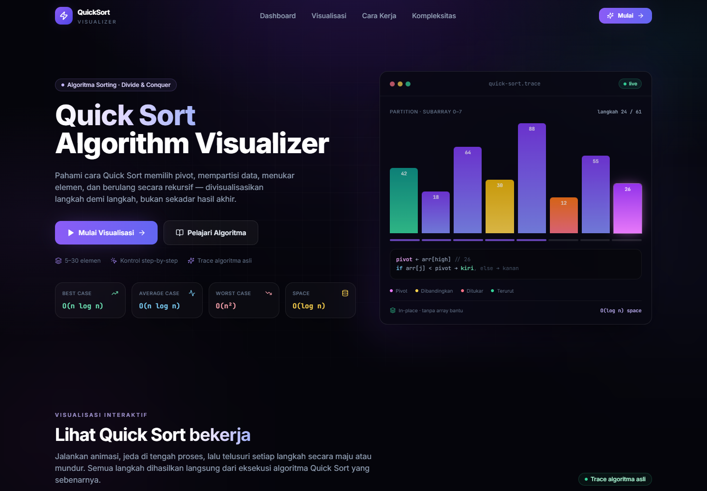
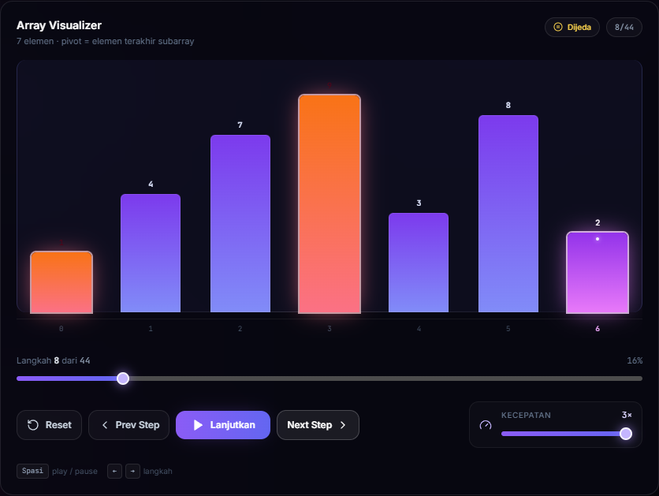

# Quick Sort Algorithm Visualizer

Website edukasi interaktif untuk memahami cara kerja algoritma **Quick Sort** langkah demi langkah. Setiap perbandingan, pertukaran, pemilihan pivot, dan pemanggilan rekursif dihasilkan dari eksekusi algoritma Quick Sort yang sebenarnya — bukan animasi statis atau data tiruan.

- **Repo:** <https://github.com/Iyan753/quicksort-visualizer>
- **Stack:** Next.js 15 · React 19 · TypeScript · Tailwind CSS · Framer Motion





---

## Daftar Isi

- [Tentang Project](#tentang-project)
- [Fitur](#-fitur)
- [Teknologi](#-teknologi)
- [Prasyarat](#-prasyarat)
- [Instalasi](#-instalasi)
- [Script yang Tersedia](#-script-yang-tersedia)
- [Build & Deploy](#-build--deploy)
- [Cara Menggunakan](#️-cara-menggunakan)
- [Cara Kerja Quick Sort](#-cara-kerja-quick-sort)
- [Kompleksitas](#-kompleksitas)
- [Struktur Project](#️-struktur-project)
- [Sistem Pencatatan Langkah](#-sistem-pencatatan-langkah-step-trace)
- [Troubleshooting](#-troubleshooting)
- [Catatan Implementasi](#-catatan-implementasi)

---

## Tentang Project

Quick Sort sering dijelaskan hanya lewat pseudocode dan diagram. Project ini mencoba pendekatan lain: **menjalankan algoritma yang asli**, merekam setiap perubahannya, lalu memutar rekaman itu sebagai visualisasi yang bisa dimajukan, dimundurkan, dan diperlambat.

Apa yang membuatnya berbeda dari animasi biasa:

| Aspek | Penjelasan |
| --- | --- |
| **Data nyata** | Semua langkah, statistik, dan penjelasan berasal dari eksekusi `buildQuickSortTrace` di [`lib/quicksort.ts`](lib/quicksort.ts). |
| **Deterministik** | Trace dibuat sekali di awal, sehingga *next/previous step* hanya memindahkan indeks — urutan langkah tidak pernah berubah. |
| **Sinkron** | Visualisasi bar, pseudocode yang tersorot, dan penjelasan teks selalu berasal dari objek langkah yang sama. |
| **Edukatif** | Setiap langkah punya judul, deskripsi, detail teknis, serta statistik perbandingan/pertukaran/kedalaman rekursi. |

Cocok untuk mahasiswa, pengajar, atau siapa pun yang ingin melihat *mengapa* Quick Sort bisa `O(n log n)` pada kasus rata-rata tetapi `O(n²)` pada kasus terburuk.

## ✨ Fitur

- **Dashboard modern** dengan ringkasan algoritma dan kompleksitas waktu/ruang.
- **Visualisasi bar interaktif** dengan warna berbeda untuk pivot, elemen yang dibandingkan, elemen yang ditukar, subarray aktif, dan elemen yang sudah terurut.
- **Kontrol lengkap**: Mulai, Pause, Next Step, Previous Step, Reset, scrubber langkah, dan pengatur kecepatan animasi (`0.5×`–`3×`).
- **Penjelasan otomatis per langkah** dalam bahasa Indonesia, lengkap dengan statistik perbandingan, pertukaran, kedalaman rekursi, dan subarray aktif.
- **Pseudocode tersorot** yang mengikuti langkah algoritma saat ini.
- **Input manual** dengan validasi, **data acak**, serta preset **Terurut**, **Terbalik**, dan **Duplikat**.
- **Panel kompleksitas** Best/Average/Worst/Space beserta penjelasan dan ilustrasi partisi seimbang vs tidak seimbang.
- **Responsive** untuk desktop, tablet, dan smartphone. Dark mode sebagai tema utama.
- **Shortcut keyboard**: `Spasi` untuk play/pause, `←` / `→` untuk langkah sebelumnya/berikutnya.
- Animasi halus dengan Framer Motion, ikon Lucide React, dan tipografi Inter + JetBrains Mono.

## 🧰 Teknologi

| Teknologi | Versi | Kegunaan |
| --- | --- | --- |
| [Next.js](https://nextjs.org/) (App Router) | 15 | Framework utama, routing, dan build |
| [React](https://react.dev/) + TypeScript | 19 / 5 | Komponen UI dan type safety |
| [Tailwind CSS](https://tailwindcss.com/) | 3 | Styling dan design system |
| [Framer Motion](https://www.framer.com/motion/) | 12 | Animasi bar, panel, dan transisi |
| [Lucide React](https://lucide.dev/) | 0.468 | Ikon |
| [Fontsource](https://fontsource.org/) | 5 | Font Inter & JetBrains Mono (lokal, tanpa request eksternal) |

---

## 📋 Prasyarat

Sebelum memulai, pastikan sudah terpasang:

| Kebutuhan | Versi minimum | Cara mengecek |
| --- | --- | --- |
| **Node.js** | 20 LTS | `node -v` |
| **npm** | 10 (ikut Node.js) | `npm -v` |
| **Git** | 2.x | `git -v` |

> Disarankan memakai Node.js 20 LTS atau 22 LTS. Versi lebih lama bisa gagal saat `next build` karena Next.js 15 membutuhkan Node.js 18.18+.

## 🚀 Instalasi

### 1. Clone repository

```bash
git clone https://github.com/Iyan753/quicksort-visualizer.git
cd quicksort-visualizer
```

Belum punya Git? Unduh ZIP lewat tombol **Code → Download ZIP** di halaman repo, lalu ekstrak dan masuk ke foldernya.

### 2. Install dependencies

```bash
npm install
```

Perintah ini membaca `package.json` + `package-lock.json` dan memasang semua dependency ke folder `node_modules/` (tidak ikut di-commit).

### 3. Jalankan development server

```bash
npm run dev
```

Buka <http://localhost:3000> di browser. Halaman akan otomatis *hot reload* setiap kali file di `app/`, `components/`, atau `lib/` diubah.

### 4. (Opsional) Cek kualitas kode

```bash
npm run typecheck   # TypeScript strict check
npm run lint        # ESLint (next/core-web-vitals)
```

### Tanpa instalasi lokal

Kalau hanya ingin melihat hasilnya, buka versi yang sudah di-deploy (isi URL Vercel Anda di sini setelah deploy pertama), atau jalankan lewat container:

```bash
docker run --rm -p 3000:3000 -v "%cd%:/app" -w /app node:20-alpine sh -c "npm ci && npm run dev -- -H 0.0.0.0"
```

> Perintah di atas untuk **Windows CMD/PowerShell**. Pengguna macOS/Linux dapat mengganti `%cd%` dengan `$(pwd)`.

## 📜 Script yang Tersedia

| Perintah | Fungsi |
| --- | --- |
| `npm run dev` | Menjalankan development server di port 3000 |
| `npm run build` | Membuat build production yang sudah dioptimasi |
| `npm start` | Menjalankan hasil build production (jalankan `build` dulu) |
| `npm run lint` | Menjalankan ESLint |
| `npm run typecheck` | Memeriksa tipe TypeScript tanpa menghasilkan file |

## 📦 Build & Deploy

### Build production secara lokal

```bash
npm run build
npm start
```

Buka <http://localhost:3000>. Jika build berhasil, folder `.next/` berisi output production.

### Deploy ke Vercel (rekomendasi)

1. Buka <https://vercel.com/new> dan login dengan akun GitHub.
2. Pilih repo **`quicksort-visualizer`** → **Import**.
3. Framework Preset terdeteksi otomatis sebagai **Next.js**. Biarkan *Build Command* (`npm run build`) dan *Output Directory* (`.next`) apa adanya.
4. Klik **Deploy**. Setiap `git push` ke `main` akan otomatis memicu deploy baru.

### Deploy ke platform lain

Project ini adalah aplikasi Next.js standar tanpa database atau environment variable, jadi bisa dijalankan di Railway, Render, Fly.io, atau VPS mana pun dengan Node.js 20+:

```bash
npm ci
npm run build
npm start   # default port 3000, ubah dengan PORT=8080 npm start
```

> Tidak ada file `.env` yang dibutuhkan. Variabel rahasia tidak dipakai di project ini.

---

## 🕹️ Cara Menggunakan

1. Atur data melalui panel **Atur Data**:
   - Ketik angka manual (5–30 bilangan bulat, nilai 1–999), lalu tekan **Terapkan** atau `Enter`.
   - Gunakan slider **Jumlah elemen**, lalu klik **Acak** untuk membuat data acak.
   - Gunakan preset **Terurut**, **Terbalik**, atau **Duplikat** untuk mengeksplorasi kasus tertentu.
2. Tekan **Mulai** untuk menjalankan animasi.
3. Gunakan **Pause**, **Prev Step**, **Next Step**, atau geser **scrubber** untuk menjelajahi langkah secara bebas.
4. Atur **Kecepatan** animasi antara `0.5×` hingga `3×`.
5. Baca panel **Penjelasan Langkah**, **Keterangan Warna**, dan **Pseudocode** yang berubah otomatis.
6. Tekan **Reset** untuk kembali ke langkah pertama.

### Aturan validasi input

- Minimal **5** dan maksimal **30** angka.
- Setiap angka harus berupa **bilangan bulat** antara **1** dan **999**.
- Pemisah boleh berupa koma, spasi, atau titik koma.
- Nilai duplikat diperbolehkan.
- Pesan error ditampilkan langsung di bawah input tanpa menghentikan visualisasi yang sedang berjalan.

### Arti warna

| Warna | Arti |
| --- | --- |
| Ungu / aksen | Pivot yang sedang dipakai |
| Kuning | Elemen yang sedang dibandingkan dengan pivot |
| Merah | Dua elemen yang sedang ditukar |
| Biru | Subarray aktif (rentang rekursi saat ini) |
| Hijau | Elemen yang posisinya sudah final/terurut |

---

## 🧠 Cara Kerja Quick Sort

Quick Sort adalah algoritma **divide and conquer** yang bekerja secara **in-place**:

1. **Pilih pivot** — pada project ini pivot adalah elemen terakhir dari subarray (`arr[high]`).
2. **Partisi (skema Lomuto)** — bandingkan setiap elemen dengan pivot. Elemen yang lebih kecil dipindahkan ke kelompok kiri; elemen yang lebih besar atau sama tetap di kanan.
3. **Tempatkan pivot** — tukar pivot ke batas antara kedua kelompok. Setelah langkah ini, posisi pivot sudah final.
4. **Rekursi** — ulangi proses pada subarray kiri dan kanan. Rekursi berhenti ketika subarray berisi nol atau satu elemen.

### Pseudocode yang diimplementasikan

```text
quickSort(arr, low, high):
  if low >= high: return
  pivot ← arr[high]
  i ← low - 1
  for j ← low to high - 1:
    if arr[j] < pivot:
      i ← i + 1
      swap(arr[i], arr[j])
  swap(arr[i + 1], arr[high])
  p ← i + 1   // pivot terkunci
  quickSort(arr, low, p - 1)
  quickSort(arr, p + 1, high)
```

Implementasi TypeScript berada di [`lib/quicksort.ts`](lib/quicksort.ts) pada fungsi `buildQuickSortTrace`.

## 📊 Kompleksitas

| Kasus | Kompleksitas | Penjelasan |
| --- | --- | --- |
| **Best Case** | `O(n log n)` | Pivot selalu membagi array menjadi dua bagian yang hampir sama besar. Kedalaman rekursi ≈ log₂ n dan setiap level memproses n elemen. |
| **Average Case** | `O(n log n)` | Pembagian tidak selalu sempurna, tetapi secara statistik tetap seimbang. Ini performa yang paling umum ditemui. |
| **Worst Case** | `O(n²)` | Pivot selalu menjadi elemen terkecil/terbesar. Setiap level hanya mengurangi satu elemen, sehingga ada ≈ n level rekursi. |
| **Space** | `O(log n)` | Quick Sort bekerja in-place. Ruang tambahan hanya untuk call stack rekursi: `O(log n)` bila partisi seimbang dan `O(n)` pada kasus terburuk. |

> Dengan strategi pivot elemen terakhir, kasus terburuk terjadi pada data yang **sudah terurut** atau **terurut terbalik**. Coba preset **Terurut** di visualizer untuk melihat jumlah langkahnya membesar.

---

## 🏗️ Struktur Project

Logika algoritma dipisahkan sepenuhnya dari komponen UI.

```text
.
├── app/
│   ├── globals.css          # Design tokens, utility, styling slider
│   ├── icon.svg             # Favicon
│   ├── layout.tsx           # Root layout, metadata, font, background
│   └── page.tsx             # Komposisi seluruh section
├── components/
│   ├── AlgorithmVisualizer.tsx  # State playback, timer, keyboard, komposisi
│   ├── ArrayBars.tsx            # Bar animasi + warna state
│   ├── ComplexityInfo.tsx       # Panel kompleksitas + ilustrasi partisi
│   ├── ControlPanel.tsx         # Play/pause/step/reset/speed/scrubber
│   ├── CustomArrayInput.tsx     # Input manual, validasi, random, preset
│   ├── Dashboard.tsx            # Hero, CTA, ringkasan kompleksitas
│   ├── FinalCta.tsx             # Ajakan mencoba di akhir halaman
│   ├── Footer.tsx
│   ├── HowItWorks.tsx           # Empat langkah inti + pseudocode
│   ├── Legend.tsx               # Keterangan warna
│   ├── Navbar.tsx               # Navigasi sticky + menu mobile
│   ├── PseudocodePanel.tsx      # Pseudocode dengan baris aktif
│   ├── SectionHeading.tsx
│   └── StepExplanation.tsx      # Penjelasan + statistik per langkah
├── lib/
│   ├── constants.ts         # Metadata fase, kompleksitas, konten edukasi
│   ├── quicksort.ts         # Algoritma asli + trace + validasi + generator data
│   └── utils.ts             # Helper className
├── docs/                    # Screenshot untuk README
├── .eslintrc.json
├── next.config.ts
├── package.json
├── postcss.config.mjs
├── tailwind.config.ts
└── tsconfig.json
```

## 🔍 Sistem Pencatatan Langkah (step trace)

`buildQuickSortTrace(input)` menjalankan Quick Sort sungguhan pada salinan array. Setiap kali state berubah, fungsi `push()` menyimpan **snapshot immutable**:

```ts
interface QuickSortStep {
  values: number[];          // nilai array pada langkah ini
  ids: string[];             // identitas stabil untuk animasi pertukaran
  pivotIndex: number | null;
  comparing: [number, number] | null;
  swapping: [number, number] | null;
  range: [number, number] | null;
  sortedIndices: number[];
  phase: "init" | "range" | "pivot" | "compare" | "swap" | "place" | "sorted" | "recurse" | "done";
  title: string;
  description: string;
  detail: string;
  stats: { comparisons: number; swaps: number; depth: number };
  codeLine: number | null;
}
```

Konsekuensinya:

- **Next/Previous Step** hanya mengubah `stepIndex` — tidak ada perhitungan ulang, sehingga urutan selalu konsisten.
- **Pause/Resume** aman karena playback memakai satu timer per langkah yang selalu dibersihkan saat pause, ganti kecepatan, atau unmount.
- **Animasi pertukaran** menggunakan `id` stabil per elemen, sehingga Framer Motion menganimasikan bar yang sama berpindah posisi, bukan sekadar mengganti nilai.
- **Penjelasan dan pseudocode** berasal dari langkah yang sama, jadi selalu sinkron dengan visualisasi.

### Menambah fitur baru

| Ingin mengubah | Sentuh file |
| --- | --- |
| Teks penjelasan tiap fase | `lib/constants.ts` |
| Warna/tema | `tailwind.config.ts`, `app/globals.css` |
| Algoritma atau strategi pivot | `lib/quicksort.ts` |
| Layout halaman | `app/page.tsx`, `components/*` |

---

## 🛠️ Troubleshooting

| Masalah | Penyebab & solusi |
| --- | --- |
| `Port 3000 is already in use` | Port dipakai proses lain. Jalankan `npm run dev -- -p 3001`, atau matikan proses lama. |
| `next: command not found` | `node_modules` belum terpasang. Jalankan `npm install`. |
| Build gagal karena versi Node | Gunakan Node.js 20+. Cek dengan `node -v`, lalu update via [nvm-windows](https://github.com/coreybutler/nvm-windows) atau [nvm](https://github.com/nvm-sh/nvm). |
| Halaman kosong / style rusak | Hapus cache build: `rm -rf .next` (PowerShell: `Remove-Item -Recurse -Force .next`), lalu jalankan ulang `npm run dev`. |
| Dependency konflik | Pasang ulang bersih: hapus `node_modules` + `package-lock.json`, lalu `npm install`. |
| Font tidak muncul | Font dibundel lewat Fontsource saat build. Pastikan `npm install` selesai tanpa error. |

## 📝 Catatan Implementasi

- Skema partisi yang dipakai adalah **Lomuto** dengan pivot elemen terakhir. Skema ini dipilih karena paling mudah dijelaskan secara visual.
- Quick Sort **tidak stabil** (unstable): urutan relatif elemen bernilai sama tidak dijamin.
- Untuk data yang sudah terurut, strategi pivot terakhir menghasilkan `O(n²)`. Di dunia nyata, pivot acak atau **median-of-three** biasanya digunakan untuk mengurangi risiko ini.
- Seluruh angka, langkah, dan statistik dihasilkan secara dinamis dari algoritma; tidak ada data simulasi statis.
- Project diverifikasi dengan `npm run typecheck`, `npm run lint`, `npm run build`, serta pengujian browser untuk play/pause/step/seek, validasi input, dan layout desktop–mobile tanpa overflow horizontal.

## 🤝 Kontribusi

Kontribusi terbuka untuk siapa saja:

1. Fork repo ini.
2. Buat branch baru: `git checkout -b fitur/nama-fitur`.
3. Commit perubahan: `git commit -m "Menambah fitur X"`.
4. Push: `git push origin fitur/nama-fitur`.
5. Buka Pull Request.

Untuk perubahan besar, sebaiknya buka **Issue** terlebih dahulu agar arah diskusinya jelas.

---

Dibuat untuk membantu mahasiswa dan pemula memahami algoritma Quick Sort secara visual dan interaktif.
